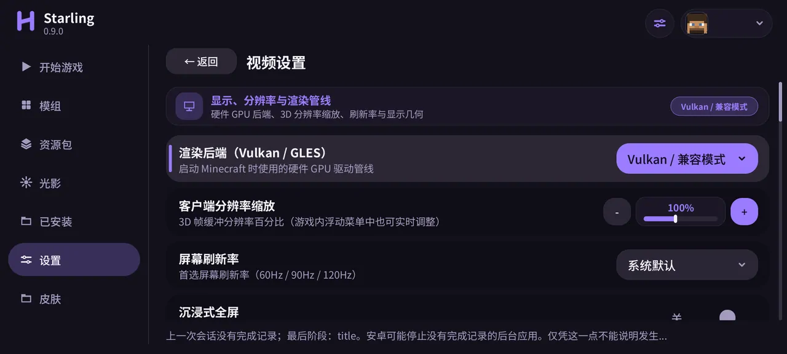
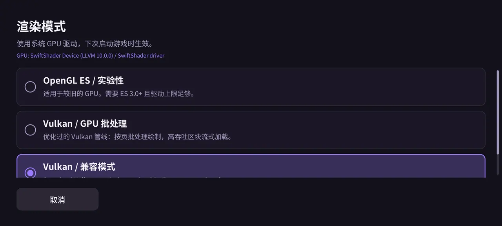
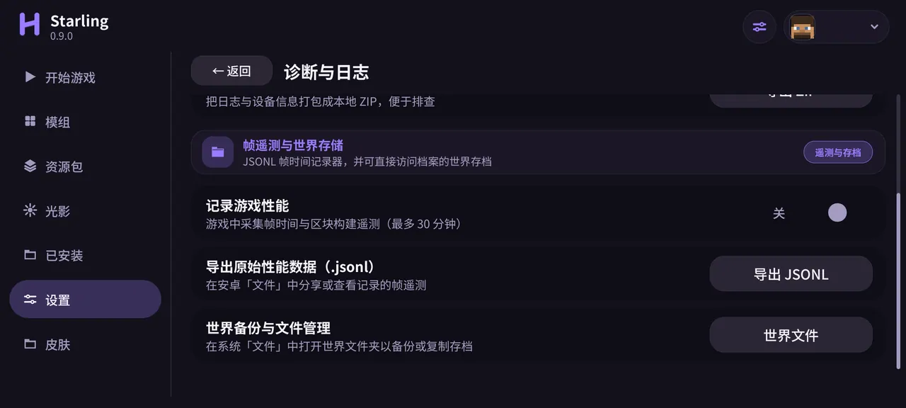

# Starling 简体中文汉化（Starling 0.9.0 / Horizon 26.3）

> 非官方汉化工程：把 [Starling](https://github.com/starling-client/starling)（Horizon 的安卓启动器 + Minecraft Java 版 Rust 实现）
> 的启动器界面、设置、向导与游戏内菜单翻成简体中文，并修掉几个和中文相关的功能性 bug。
>
> 基于上游 MIT 许可二次分发；与 Mojang / Microsoft 无关。

## 下载

**最新版：[v0.9.0-zh-cn.4](../../releases/latest)**（arm64-v8a，Android 8+）

| 文件 | 大小 | SHA-256 |
|---|---|---|
| `starling-0.9.0-arm64-v8a-zh-cn-built-r16.apk` | 222.8 MiB | `75c466121f5c49afeb1aef11ddf3b3c17c7bd98845b1b3ee22d40dbd6570068e` |
| `SHA256SUMS.txt` | — | 校验用（`sha256sum -c`） |

- 覆盖安装即可：同签名保留数据，换签名需先卸载（存档在 `Starling` 文件夹，不受影响）。
- Java 运行时已内置；首次启动只需联网下载游戏资源（约 1.5 GB）。
- APK 内 `assets/licenses/` 随附 MIT 许可证全文、第三方声明与合规说明。

## 这个版本做了什么

| 方面 | 内容 |
|---|---|
| 启动器界面 | 侧边栏、开始游戏、模组、资源包、光影、已安装、设置、皮肤、账户、诊断等全部页面中文化 |
| 设置向导 | 登录、离线档案、文件卡片、下载与准备页（含缺字修复） |
| 游戏内菜单 | 选项、语言、资源包、控制、音乐、辅助功能等简洁版设置页 |
| 微软登录 | 改用旧版 MSA 设备码流程（`login.live.com/oauth20_connect.srf`），登录页自动带出代码；登录后浏览器不再报 `invalid_request` |
| 中文渲染 | 字体替换为 Noto Sans SC 合并字体；图集字形区域扩容，修掉“切出去再回来整片缺字” |
| 语言设置 | 默认语言真正存成 `zh_cn`，语言列表不会再出现“界面中文、选中 English” |

完整改动见 [CHANGES.md](CHANGES.md)；每轮的来龙去脉见 [docs/ENGINEERING_LOG.md](docs/ENGINEERING_LOG.md)；
发行合规说明（不含哪些 Mojang 资源、字体许可、语言文件来源）见 [NOTICE.md](NOTICE.md)。
正版登录的实现思路见 [docs/LOGIN.md](docs/LOGIN.md)。

## 截图

| 启动器 · 视频设置 | 渲染后端选择 |
|---|---|
|  |  |



## 仓库内容

```
i18n/i18n_zh.rs              启动器词库（ZH 精确表 + ZH_EXTRA 子串表）
i18n/zh_cn.json              内置语言文件（assets/horizon/lang/zh_cn.json）
packaging/minecraft-zh_cn.json  皮肤包语言文件（必须与上面那份保持一致）
packaging/pack.mcmeta        语言声明（zh_cn / en_us），语言列表靠它
scripts/build_zh_mac.sh      macOS 上交叉编译 libhorizon_android.so
docs/HANDOVER.md             构建、装机、调试的完整说明
docs/ENGINEERING_LOG.md      每轮改了什么、怎么验证、遗留问题
docs/HANDOVER_PROMPT.md      继续这个项目时的速查
docs/LOGIN.md                微软正版登录的排查与修复思路
third_party/jre25/          OpenJDK 25 的许可证与来源说明（APK 内也随附）
NOTICE.md                    发行合规说明（不含 Mojang 资源、字体许可、语言文件来源）
CHANGELOG.md                 版本记录
fonts/OFL.txt                Noto Sans SC / Geist 的 SIL OFL 1.1 许可证
THIRD_PARTY_NOTICES.md       上游的第三方声明（原样保留）
```

## 构建

1. 准备上游源码树与 Rust、Android NDK r27c（脚本会检查，缺了会自己下）。
2. **字体**：把 `crates/horizon-theme/fonts/Geist-{Regular,Medium,SemiBold}.ttf` 与 `GeistMono-Regular.ttf`
   换成 Noto Sans SC（可只保留常用字以减小体积）合并 Geist 字重的字体；不换的话中文会显示成方框。
   字体不在仓库里（体积 + SIL OFL 授权），Release 的 APK 已内置。
3. 应用语言文件：把 `i18n/zh_cn.json` 放到 `crates/horizon-client/assets/horizon/lang/zh_cn.json`，
   `packaging/minecraft-zh_cn.json` 放到 `packaging/lowbudget/pack/assets/minecraft/lang/zh_cn.json`。
4. `bash scripts/build_zh_mac.sh`，产物是 `target/aarch64-linux-android/fast/libhorizon_android.so`。
5. 替换 APK 里的 `lib/arm64-v8a/libhorizon_android.so`、重建 `assets/lowbudget.zip`，`zipalign` + `apksigner` 签名。

## 已知问题

- 简洁版设置里仍有少量原生英文（如 `Auto Sprint` 之外的个别按键名），属于上游 Horizon 新增功能。
- “Horizon 设置”页的页面说明已改为只显示在底部说明条（之前会浮在按钮上）。
- 微软登录依赖微软自家客户端 id `00000000402b5328`；若微软调整旧版设备码流程，登录可能需要再适配。

## 许可证

**本项目整体以 MIT 许可证分发**，全文见 [LICENSE](LICENSE)。

- 上游 Starling / Horizon 代码：版权归 Ludovic Marie 与 Horizon 贡献者，MIT；
- 简体中文汉化层（`i18n/`、`packaging/` 下的语言文件）：由 wenrongxx 整理与翻译，同样以 **MIT** 授权，
  可自由使用、修改与再分发，保留出处即可；
- 语言文件中的 Minecraft 英文原文与官方简体中文译文：版权归 Mojang 与原译者，
  **不在本项目的授权范围内**，本项目只对“整理、补充与修订”的部分主张版权。

非 MIT 组件（详见 [NOTICE.md](NOTICE.md)）：

| 组件 | 许可证 | 版权 / 来源 |
|---|---|---|
| OpenJDK 25（APK 内置） | GPLv2 + Classpath Exception | OpenJDK / AngelAuraMC，见 [third_party/jre25/](third_party/jre25/) |
| Noto Sans SC、Geist 字体 | SIL OFL 1.1 | Adobe / Google / The Geist Project，见 [fonts/OFL.txt](fonts/OFL.txt) |
| Minecraft 游戏资源（jar、assets、官方贴图） | 不随本项目分发 | Mojang |

本项目是非官方社区汉化，与 Mojang、Microsoft、Starling 及 Horizon 项目**没有隶属关系**；
“Minecraft” 是 Mojang 的商标。

## 致谢

- [starling-client/starling](https://github.com/starling-client/starling) 与上游 Horizon 项目
- Noto Sans SC（Google Fonts）
